# Manual de uso · AST DIGITAL 3.2

Taller SMAN · SM Cyclo de Chile Ltda.

---

## 1. Taller: crear la AST del día

### 1.1 Entrar

1. Escanea el código QR del taller o abre el enlace de la app.
2. Toca **INGRESAR A TALLER SMAN**.
3. La primera vez en ese teléfono escribe tu nombre, RUT y cargo, y toca **Continuar**. Las veces siguientes la app ya te reconoce.

El inicio muestra dos tarjetas:

- **INGRESA A TALLER SMAN**: abre las áreas del taller.
- **FIRMAS PENDIENTES**: muestra cuántas AST de hoy están esperando firma.

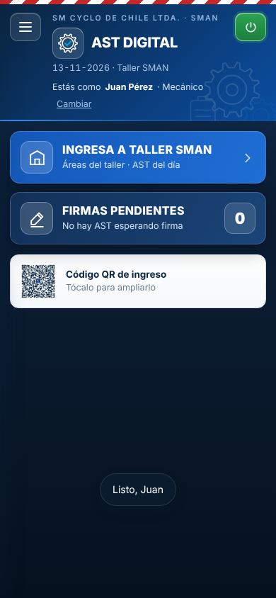

### 1.2 Elegir el área

Toca tu área. Cada cuadro muestra cuántas líneas tienen su AST autorizada hoy.
Un número rojo indica AST esperando firma: no empieces el trabajo hasta que tu AST esté en verde.

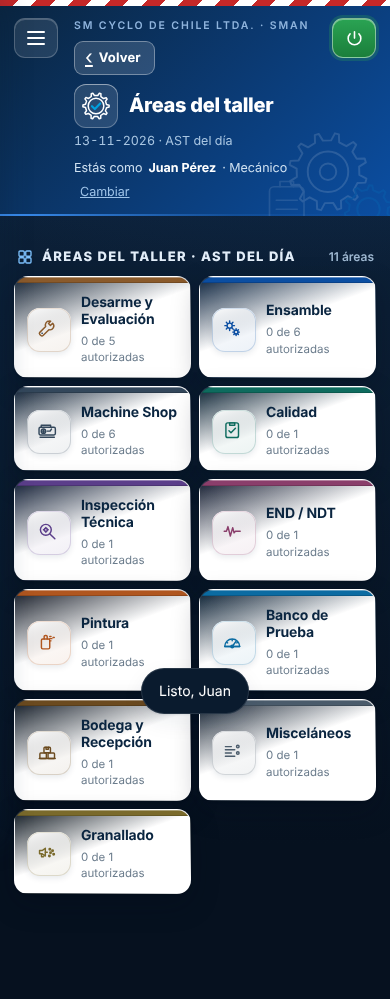

En un computador o notebook las 11 áreas se ven completas, sin bajar la pantalla:

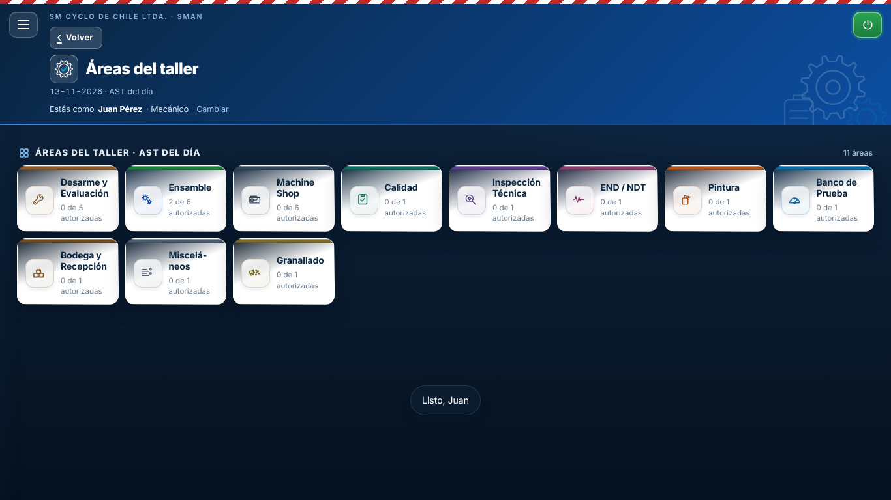

### 1.3 Llenar la AST

Al crear la AST, todos los cuadros aparecen **cerrados**. Toca el título o la flecha para abrir uno; vuelve a tocarlo para cerrarlo.
Solo queda un cuadro abierto a la vez: al abrir otro, el anterior se cierra solo.
Al lado de cada título ves el estado: *Pendiente*, *Completo*, *Sin firma*…

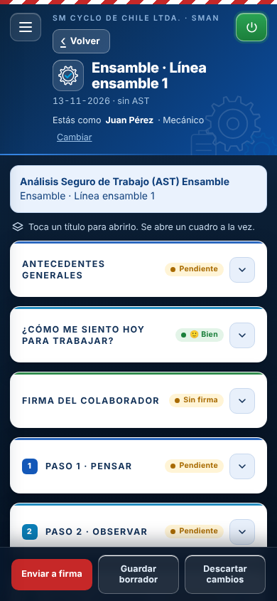

1. **Antecedentes generales:** describe el trabajo y el lugar. En **Se envía a firma de** elige quién debe autorizar.
   - La lista muestra a las personas habilitadas para firmar, con su nombre tal como está registrado.
   - Si la persona no está en la lista, elige **Otros** y escribe su nombre. En ese caso la AST la firma un responsable con permiso de firma, y queda registrado el nombre de quien firmó realmente.
2. **¿Cómo me siento hoy para trabajar?**
3. **Pasos 1 a 5:** responde las preguntas y marca los riesgos que aplican.
4. **Firma del colaborador:** firma con el dedo dentro del recuadro.
5. Toca **Enviar a firma** en la barra de abajo.

La barra de botones va siempre abajo y nunca tapa lo que estás escribiendo.
**Volver** está arriba, junto al título. Si vuelves, lo escrito no se pierde.

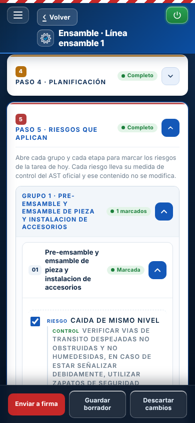

---

## 2. Supervisión: firmar y aprobar

### 2.1 Entrar con tu cuenta

1. En la pantalla de ingreso escribe tu usuario y tu contraseña.
2. El **ojo** al lado de la contraseña la muestra u oculta, para revisar que la escribiste bien.
3. La primera vez la app te pide cambiar la clave temporal por una tuya.

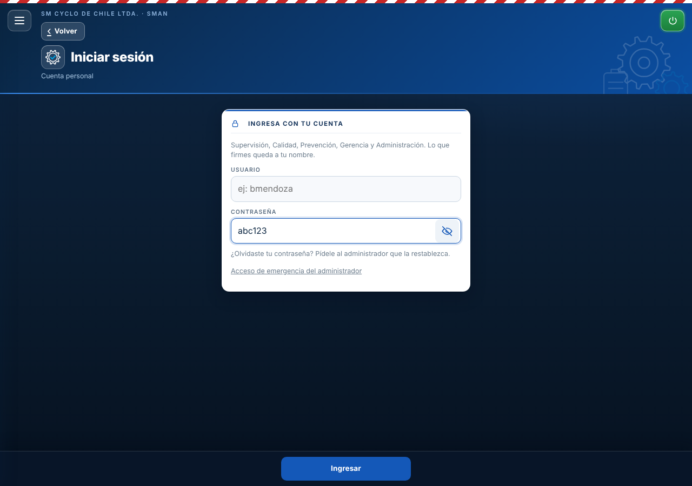

### 2.2 Firmar

1. En el inicio, toca **FIRMAS PENDIENTES** o el aviso rojo «Tienes N AST esperando tu firma».
2. Revisa el resumen de la AST.
3. Firma en el recuadro y toca **Firmar y autorizar**.
4. La AST pasa a verde y recibe su **número oficial** (correlativo). El número lo asigna la base de datos y nunca se repite.

Si algo está mal, toca **Devolver a corrección**.

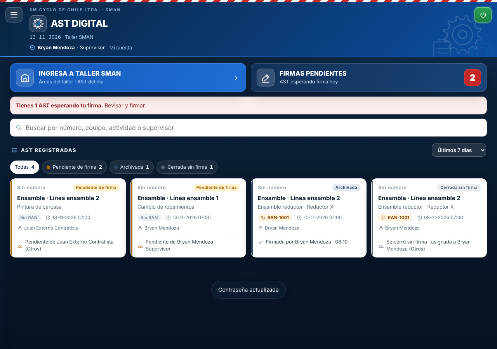
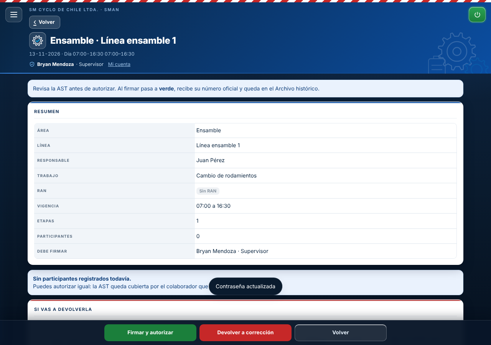

Al ver una AST firmada, sus cuadros también parten cerrados y se abren de a uno:

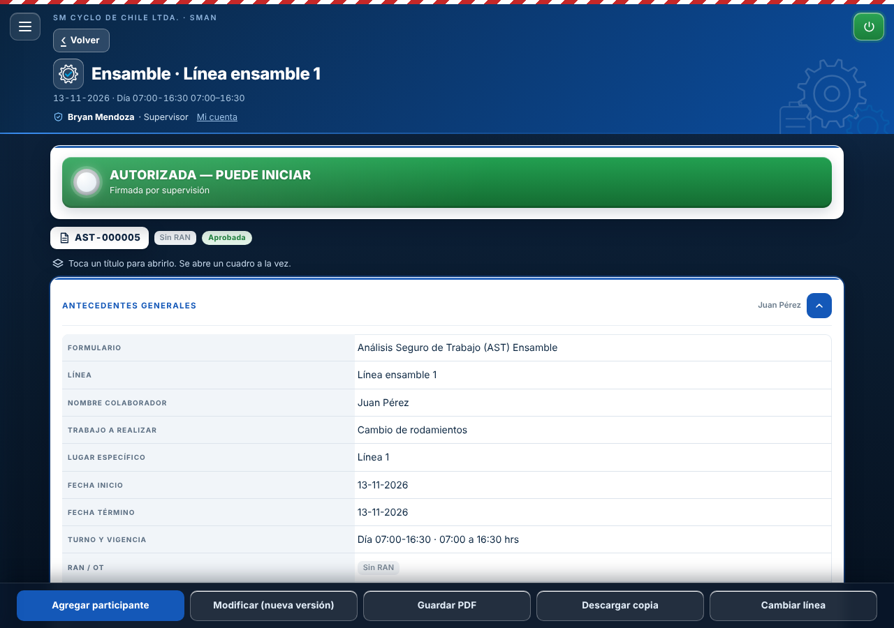

---

## 3. Agregar a alguien que llega después de la firma

Si una persona se suma al trabajo cuando la AST ya está firmada:

1. Abre la AST de esa línea (Áreas del taller → tu área → tu línea).
2. Toca **Agregar participante**.
3. La persona escribe su nombre y RUT, y lee la declaración:

   > Declaro haber participado en la charla previa, haber tomado conocimiento de los riesgos y las medidas de control definidas en este AST, y conocer mi derecho y mi obligación de detener el trabajo ante cualquier condición insegura.

4. Marca **Acepto la declaración**, firma y toca **Firmar e incorporarme**.

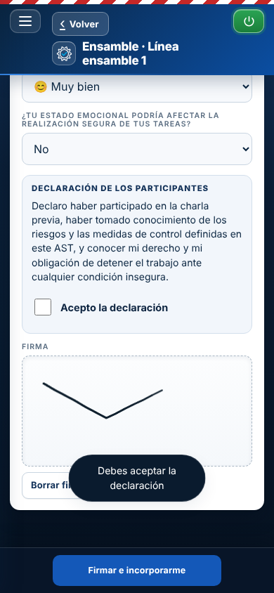

Qué pasa:

- Queda en la **misma AST, con el mismo número**. No se crea una AST nueva.
- Las firmas anteriores no cambian.
- En la lista de participantes aparece: «Se incorporó después de la firma · fecha y hora · registró *nombre*».
- Queda anotado en el historial de accesos.
- Si hay que cambiar el contenido de seguridad de una AST firmada (riesgos, controles), no se edita: se hace una revisión nueva, que pasa otra vez por firma.

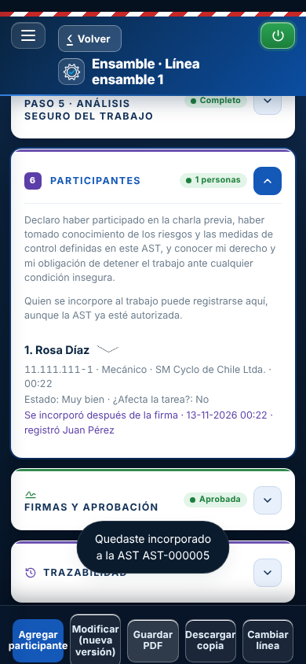

---

## 4. Administración

### 4.1 Usuarios

**Menú → Usuarios.**

- **Nuevo usuario:** nombre, usuario, perfil y clave temporal. El ojo deja ver la clave temporal para entregarla.
- **Deshabilitar:** la persona ya no puede entrar y desaparece de «Se envía a firma de». Sus firmas anteriores quedan intactas.
- **Clave de emergencia:** para cambiar la clave de emergencia del administrador.

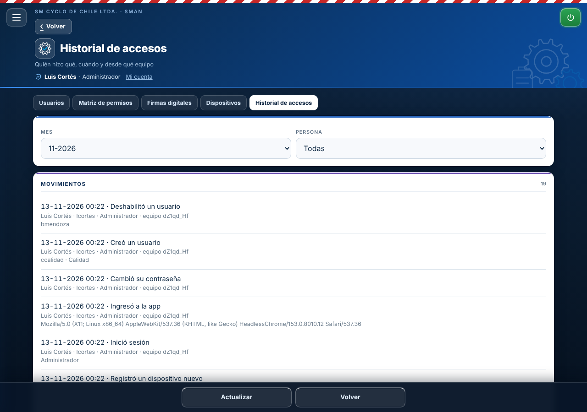

### 4.2 Acceso de emergencia del administrador

Sirve para el primer ingreso o si se pierde el acceso de administración.

1. En la pantalla de ingreso toca **Acceso de emergencia del administrador**.
2. Escribe la clave de emergencia, tu usuario de administrador y una contraseña nueva (dos veces).
3. Si el usuario no existe, escribe también nombre y apellido: se crea una cuenta de administrador nueva.
4. Toca **Recuperar acceso**. Entras como administrador con tu contraseña nueva.

Medidas de seguridad:

- La clave de emergencia no sirve para iniciar sesión directo: solo deja crear o recuperar tu propia contraseña.
- Después de 3 intentos fallidos, ese equipo queda bloqueado 15 minutos.
- Cada intento, correcto o fallido, queda en el historial de accesos.
- La clave no está guardada en la app: está cifrada en el servidor.
- No sirve para entrar a cuentas de supervisión ni de otros perfiles.

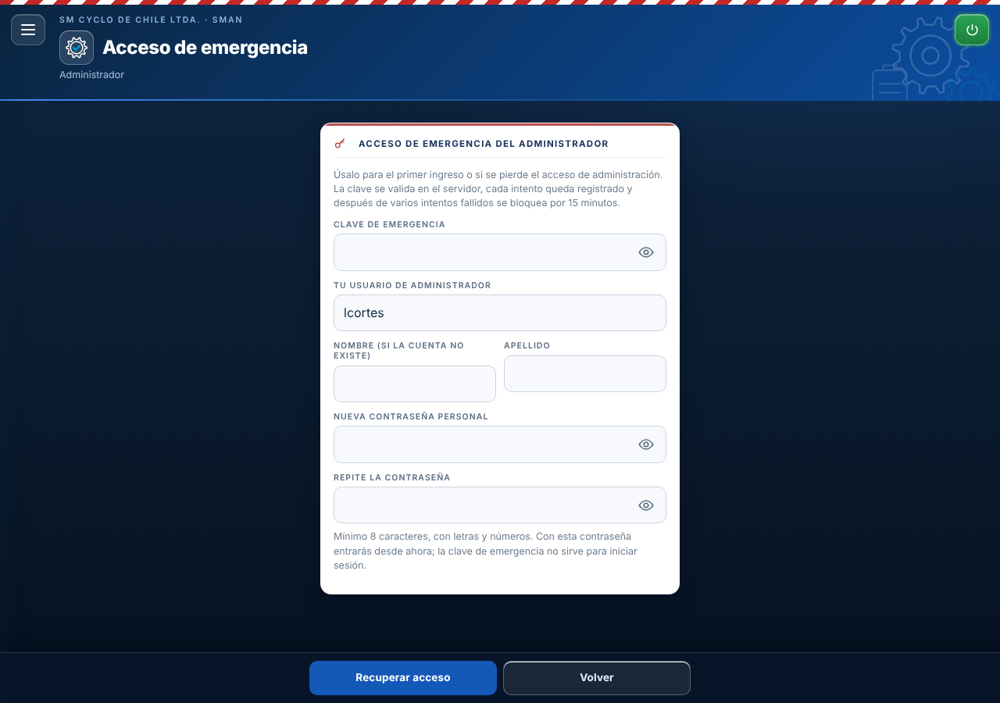
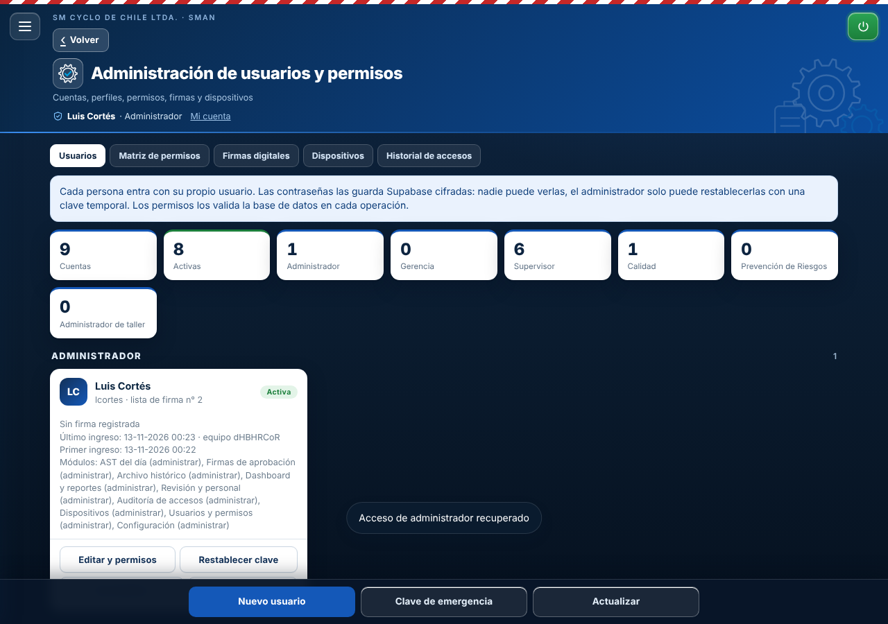

---

## 5. Revisión rápida después de publicar (en la base real)

Hazla una vez, con dos personas y un teléfono:

1. [ ] El inicio muestra las dos tarjetas compactas, sin la tarjeta grande.
2. [ ] Crear una AST de prueba: todos los cuadros parten cerrados y se abren de a uno.
3. [ ] «Se envía a firma de» muestra los nombres correctos y la opción «Otros».
4. [ ] El supervisor firma y la AST recibe su número.
5. [ ] Agregar un participante después de la firma: el número no cambia.
6. [ ] El ojo de la contraseña funciona.
7. [ ] Probar el acceso de emergencia una vez y luego cambiar la clave de emergencia.
8. [ ] Anular la AST de prueba si no corresponde a un trabajo real (las AST no se borran).
